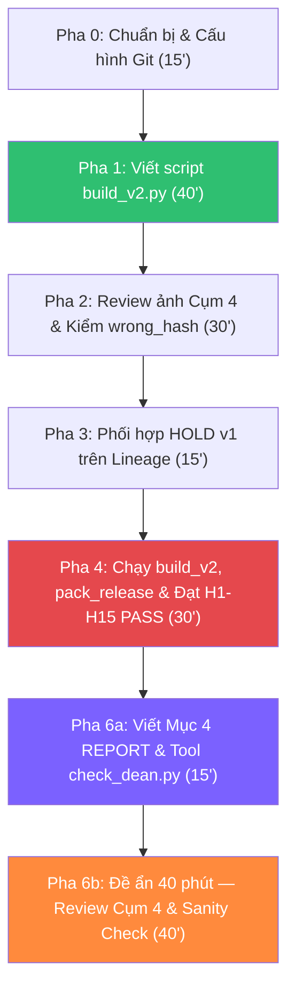

# KẾ HOẠCH HÀNH ĐỘNG CHI TIẾT — THÀNH VIÊN 4 (phuchoangpath)
**Dự án:** Day 10 Lab — Bàn giao dataset & Truy vết (Dataset Release & Handover)  
**Vai trò:** Kỹ sư Bàn giao Lô v2 (7 thành phần, `README.txt`, `pack_release`) & Sanity Check Đề ẩn  
**Thành viên:** `TV4 — phuchoangpath`  
**File phụ trách chính:**
- `tools/build_v2.py` (Script tự động đóng gói lô v2 chuẩn 15 tiêu chí H1–H15)
- `handover/<RID>_v2/README.txt` (Hồ sơ bàn giao lô v2)
- `tools/check_dean.py` (Script sanity check quét nhanh bài nộp Đề ẩn)
- `submission/REPORT.md` (Mục 4: *Hash chứng minh gì và không chứng minh gì*)
- `submission/prompts.md` (Ghi nhận nhật ký minh bạch sử dụng AI)
- Review mắt 20% ảnh ứng viên (Cụm 4) trong `review_log.csv`

---

## 🛡️ NGUYÊN TẮC BẢO ĐẢM KHÔNG VI PHẠM NỘI QUY (RULES.MD & RUBRIC)

1. **KHÔNG sửa bất kỳ file nào trong thư mục `scripts/`:** Bộ kiểm tra thi chạy lại bằng bản gốc của script. Bất kỳ sự can thiệp nào vào `check_handover.py` hay `pack_release.py` $\rightarrow$ **0 điểm Mục 3**.
2. **KHÔNG sửa đè thư mục `delivery/` (lô v1):** Lô v1 phải giữ nguyên vẹn từng byte (mã hash nhãn, mask, panoptic không đổi). Bản sửa lỗi phải nằm riêng ở thư mục lô v2.
3. **KHÔNG dùng AI thay thế việc xem ảnh:** Mọi dòng `confirmed` trong `review_log.csv` phải do người thật nhìn ảnh, ghi chú rõ thấy gì trong ảnh ($\ge 20$ ký tự, $\ge 70\%$ ghi chú không trùng nhau). Thầy cô sẽ vấn đáp ngẫu nhiên hỏi bạn đã thấy gì trong ảnh đó.
4. **Minh bạch khi dùng AI:** Được phép dùng AI viết script (`tools/build_v2.py`, `tools/check_dean.py`) và giải thích lý thuyết, nhưng **phải ghi lại tóm tắt prompt vào file `submission/prompts.md`**.
5. **KHÔNG commit file rác:** Không đưa `data_source/`, `runs/`, các file nén `*.zip` lên Git. Chỉ commit mã nguồn, tài liệu báo cáo và các file nộp bài trong `submission/`.
6. **Đảm bảo tối thiểu 3 commit cá nhân:** Mang đúng tên `phuchoangpath` và email của bạn trên Git theo các mốc P1, P4, P6a.

---

## 📅 LỘ TRÌNH THỰC HIỆN CHI TIẾT THEO TỪNG GIAI ĐOẠN



---

### 🟢 PHA 0: Chuẩn bị & Cấu hình môi trường (Thời lượng: ~15 phút)

#### 1. Ý nghĩa & Ứng dụng thực tế
Trong kỹ nghệ phần mềm và quản lý dữ liệu lớn (Data Engineering), tính minh bạch và truy vết nguồn gốc (Audit Trail) bắt đầu từ việc định danh chính xác người thực hiện thao tác trên Git. Việc chuẩn bị môi trường và dữ liệu thử nghiệm độc lập giúp kỹ sư tự kiểm thử công cụ mà không làm ảnh hưởng đến dữ liệu chính thức của nhóm.

#### 2. Phân công công việc
- 🤖 **AI làm hộ:**
  - Soát cấu hình môi trường Python (Python 3.10+).
  - Cung cấp cú pháp cấu hình Git chuẩn xác cho `phuchoangpath`.
- 👤 **Bạn làm tay:**
  - Mở PowerShell tại thư mục repo và thiết lập Git identity:
    ```powershell
    git config user.name "phuchoangpath"
    git config user.email "email_cua_ban@example.com"
    ```
  - Chạy lệnh tải dữ liệu công khai COCO và tạo lô thử nghiệm `runs/r11` (nếu máy bạn chưa có):
    ```powershell
    py scripts/download_public.py
    py scripts/inject_release.py --seed 11 --out runs/r11
    ```

#### 3. Bẫy cần tránh (Pitfalls)
- Không gõ sai tên `user.name` (phải là `phuchoangpath` để khớp với [team-tracker.html](team-tracker.html) và rubric chấm điểm cá nhân).

---

### 🟢 PHA 1: Xây dựng công cụ tự động đóng gói lô v2 `tools/build_v2.py` (Thời lượng: ~40 phút) ⭐ TRỌNG TÂM KỸ THUẬT

#### 1. Ý nghĩa & Ứng dụng thực tế
- **Data Versioning Pipeline:** Trong các dự án AI, khi dữ liệu phát hiện có lỗi, nghiêm cấm việc chỉnh sửa thủ công trực tiếp lên dữ liệu gốc (In-place Overwrite). Kỹ sư dữ liệu phải xây dựng một script đóng gói tự động để:
  1. Loại bỏ các mẫu hỏng ra khỏi tập huấn luyện và đưa vào hàng đợi làm lại (`rework_queue.csv`).
  2. Giữ nguyên vẹn các mẫu dữ liệu hợp lệ (không chỉnh sửa byte của nhãn).
  3. Cập nhật lại siêu dữ liệu (`manifest.csv`, `label_summary.csv`, `truyvet.csv`) hoàn toàn tự động.

#### 2. Phân công công việc
- 🤖 **AI làm hộ (100%):**
  - Viết toàn bộ file `tools/build_v2.py` thỏa mãn đầy đủ các điều kiện kiểm tra từ H1 đến H15 của `scripts/check_handover.py`:
    - **Tách đúng 7 lỗi Detection** (`DET_REWORK = {"missing_image", "invalid_class", "bbox_out_of_bounds", "duplicate_box", "class_swap", "bbox_drift", "missing_box"}`): Đưa vào `rework_queue.csv` kèm `annotator` và `reviewer` tra từ `jobs.csv`, đồng thời **loại bỏ hoàn toàn khỏi `v2/images/` và `v2/labels/`**.
    - **Giữ lại trong `v2` các ảnh chỉ bị lỗi Panoptic** (`invalid_category_id`, `thing_overlap`, `category_swap`, `instance_merge`): Vì không làm sai nhãn Detection, ảnh vẫn được giữ lại; script tự tổng hợp danh sách ảnh này để đưa vào phần Ghi chú của `README.txt`.
    - **Sửa lỗi Metadata trực tiếp trong v2:**
      - Cảnh bị `scene_leak`: gom toàn bộ ảnh trong cảnh về split chiếm đa số trong `truyvet.csv`.
      - Ảnh bị `guideline_mismatch`: cập nhật phiên bản guideline trong `truyvet.csv` khớp đúng `jobs.csv`.
    - **Tính mã SHA-256 binary thật:** Tạo `manifest.csv` chứa đường dẫn định dạng POSIX (`images/xxx.jpg`, `labels/xxx.txt`), tuyệt đối không dùng dấu gạch chéo ngược Windows (`\`).
    - **Đếm thống kê nhãn:** Tạo `label_summary.csv` khớp chính xác số lượng nhãn theo `classes.txt` kèm dòng `TOTAL`.
    - **Sinh file `README.txt`:** Điền sẵn các thông tin Release, Parent, Số ảnh, Số nhãn, mẫu số QC v1, kết luận Hold/Release và ghi chú chi tiết.
- 👤 **Bạn làm tay:**
  - Lưu file `tools/build_v2.py` vào thư mục dự án và chạy kiểm tra:
    ```powershell
    py tools/build_v2.py --help
    ```
  - Thực hiện **Commit 1**:
    ```powershell
    git add tools/build_v2.py
    git commit -m "P1: xay dung script tu dong tao 7 thanh phan lo ban giao v2"
    ```

#### 3. Bẫy cần tránh (Pitfalls)
- Trên Windows, đường dẫn file trong `manifest.csv` nếu để dạng `images\001.jpg` sẽ bị fail tiêu chí H8. Script bắt buộc phải dùng `.as_posix()` để có dạng `images/001.jpg`.
- Không đưa nhầm ảnh chỉ lỗi panoptic vào `rework_queue.csv` (vi phạm H5).
- Không sửa nội dung bất kỳ file nhãn `.txt` nào trong `v2/labels/` (vi phạm H7).

---

### 🟢 PHA 2: Review ảnh bằng mắt Cụm 4 & Kiểm chứng `wrong_hash` (Thời lượng: ~30 phút)

#### 1. Ý nghĩa & Ứng dụng thực tế
- **Human-in-the-Loop Verification:** Máy tính chỉ có thể phát hiện các điểm "bất đồng" giữa nhãn Detection và Panoptic. Chỉ có con người mở ảnh ra xem mới xác định được nhãn bên nào đúng, bên nào sai.
- **Data Integrity Assurance:** Mở xem ảnh bị `wrong_hash` nhằm xác nhận file ảnh vẫn hiển thị bình thường (chỉ do người đóng gói manifest ghi nhầm hash), không bị lỗi tệp tin hỏng (corrupted file) trước khi cho phép giữ lại trong v2.

#### 2. Phân công công việc
- 🤖 **AI làm hộ:**
  - Hướng dẫn phân biệt nhanh:
    - `class_swap` (nhãn detection sai) vs `category_swap` (nhãn panoptic sai).
    - `bbox_drift` (hộp detection bị lệch hẳn khỏi vật).
    - `instance_merge` (panoptic gộp 2 vật vào 1 segment).
  - Soát lại định dạng dòng review: Ghi chú $\ge 20$ ký tự, có tag `[phuchoangpath]`.
- 👤 **Bạn làm tay (Bắt buộc người thật):**
  - Mở công cụ review ảnh (do TV3 cung cấp, ví dụ `review_board.html`), xem toàn bộ các ảnh thuộc **Cụm 4** (20% ảnh ứng viên được phân công).
  - Mở xem trực tiếp các file ảnh dính lỗi `wrong_hash` trong `runs/r<SEED>/delivery/images/` để xác nhận ảnh nguyên vẹn.
  - Ghi nhận xét chi tiết vào file review log (Ví dụ: *"xe tải mui kín loại lớn, detection ghi car nhầm lớp [phuchoangpath]"*). Gửi kết quả cho TV3 tổng hợp.

#### 3. Bẫy cần tránh (Pitfalls)
- Ghi chú quá ngắn hoặc chép giống nhau (dưới 20 ký tự hoặc trùng lặp $> 30\%$) sẽ bị fail tiêu chí H3.

---

### 🟢 PHA 3: Quyết định Release / Hold & Ghi nhận Lineage (Thời lượng: ~15 phút)

#### 1. Ý nghĩa & Ứng dụng thực tế
- **Quality Gatekeeping:** Áp dụng nguyên tắc quản lý chất lượng ngưỡng 2%: Nếu tỷ lệ ảnh lỗi $> 2\%$, lô dữ liệu không được phép phát hành (phải gắn nhãn HOLD) nhằm ngăn chặn rủi ro làm hỏng quá trình huấn luyện mô hình. Nhật ký dòng dõi (`lineage.jsonl`) đóng vai trò như sổ cái bất biến ghi lại mọi quyết định kiểm định.

#### 2. Phân công công việc
- 🤖 **AI làm hộ:**
  - Tính toán tỷ lệ lỗi từ `errors.json` của nhóm để khẳng định lô v1 phải HOLD.
- 👤 **Bạn làm tay:**
  - Phối hợp với TV1 kiểm tra xem lệnh HOLD đã được ghi vào lineage chưa:
    ```powershell
    py scripts/lineage.py record --event decision --release-id <RID_V1> --decision HOLD --reason "ti le loi > 2%"
    ```

---

### 🟢 PHA 4: Đóng gói Lô v2, README.txt & Chạy kiểm H1–H15 (Thời lượng: ~30 phút) ⭐ TRỌNG TÂM KỸ THUẬT

#### 1. Ý nghĩa & Ứng dụng thực tế
- **Release Packaging & Compliance:** Bước xuất xưởng dữ liệu hoàn chỉnh. Một gói bàn giao chuẩn kỹ nghệ bao gồm: dữ liệu sạch, hàng đợi sửa chữa cho bên gán nhãn, thống kê phân phối lớp nhãn, bảng truy vết nguồn gốc, bản ghi tóm tắt quyết định (`README.txt`) và mã băm SHA-256 bảo chứng toàn vẹn cho gói nén.

#### 2. Phân công công việc
- 🤖 **AI làm hộ:**
  - Soát và điền chính xác nội dung `README.txt` của lô v2 (khớp số ảnh, số nhãn, mẫu số QC v1, kết luận và ghi chú giải trình).
  - Phân tích log nếu `check_handover.py` báo bất kỳ lỗi FAIL nào và hướng dẫn sửa ngay lập tức.
- 👤 **Bạn làm tay:**
  - Chạy script đóng gói trên seed chính thức của nhóm (ví dụ seed `3007`):
    ```powershell
    py tools/build_v2.py --run runs/r3007
    ```
  - Chạy script nén và tính mã băm cho gói bàn giao v2:
    ```powershell
    py scripts/pack_release.py runs/r3007/handover/<RELEASE_ID>_v2
    ```
  - Ghi nhận sự kiện phát hành v2 có nguồn gốc từ v1 vào lineage:
    ```powershell
    py scripts/lineage.py record --event release --release-id <RELEASE_ID>_v2 --parent <RELEASE_ID>
    ```
  - Chạy bộ kiểm định bàn giao chính thức:
    ```powershell
    py scripts/check_handover.py --run runs/r3007
    ```
    *(Mục tiêu: Đạt [PASS] toàn bộ từ H1 đến H15).*
  - Thực hiện **Commit 2**:
    ```powershell
    git add tools/build_v2.py
    git commit -m "P4: hoan thien dong goi lo v2 dat H1-H15 PASS"
    ```

#### 3. Bẫy cần tránh (Pitfalls)
- **CỰC KỲ QUAN TRỌNG:** Nếu chỉnh sửa bất kỳ một chữ nào trong `README.txt` sau khi nén, **bắt buộc phải chạy lại `pack_release.py`** để cập nhật lại file `.sha256`, nếu không sẽ bị fail tiêu chí H15.

---

### 🟢 PHA 6a: Viết Báo Cáo Mục 4 & Tool Sanity Check Đề Ẩn (Thời lượng: ~15 phút)

#### 1. Ý nghĩa & Ứng dụng thực tế
- **Data Governance & Integrity Defense:** Phân biệt rõ bản chất của mã băm mật mã học (cryptographic hash): SHA-256 chỉ đảm bảo tính toàn vẹn vật lý (chống suy hao bit, chống sửa đổi ngầm), hoàn toàn không chứng minh được dữ liệu có đúng về mặt ngữ nghĩa (nhãn đúng đối tượng) hay có vi phạm bảo mật/quyền riêng tư hay không.

#### 2. Phân công công việc
- 🤖 **AI làm hộ (100%):**
  - Soạn sẵn toàn bộ nội dung học thuật cho **Mục 4 trong file `submission/REPORT.md`** (*Hash chứng minh gì và không chứng minh gì*).
  - Viết script `tools/check_dean.py` giúp nhóm tự động kiểm tra định dạng của 4 file đề ẩn trong 1 giây (bảo đảm mọi lỗi gán nhãn đều có dòng `confirmed`, ghi chú $\ge 20$ ký tự, JSON chuẩn cú pháp).
  - Cập nhật nhật ký sử dụng AI vào file `submission/prompts.md`.
- 👤 **Bạn làm tay:**
  - Đọc kỹ nội dung Mục 4 trong `REPORT.md` để nắm chắc kiến thức sẵn sàng trả lời vấn đáp.
  - Thực hiện **Commit 3**:
    ```powershell
    git add tools/check_dean.py submission/REPORT.md submission/prompts.md
    git commit -m "P6a: viet muc 4 REPORT (hash) va tool check_dean.py"
    ```

---

### 🟢 PHA 6b: Thực chiến Đề ẩn 40 phút & Kiểm tra bài nộp (Thời lượng: ~40 phút)

#### 1. Ý nghĩa & Ứng dụng thực tế
- Thử nghiệm trực tiếp năng lực vận hành quy trình dưới áp lực thời gian thực tế với bộ dữ liệu ẩn hoàn toàn mới (đã mã hóa tên ảnh, không có nhãn gốc).

#### 2. Phân công công việc
- 🤖 **AI làm hộ:**
  - Chạy `tools/check_dean.py` quét toàn bộ thư mục `submission/de_an/` để phát hiện ngay các lỗi thiếu sót trước khi TV1 bấm nộp bài.
- 👤 **Bạn làm tay:**
  - Dành 20 phút tập trung cao độ review Cụm 4 của đề ẩn.
  - Phút 32–36: Chạy lệnh tự kiểm tra:
    ```powershell
    py tools/check_dean.py --delivery delivery --sub submission/de_an
    ```
  - Kiểm tra trên web GitHub xác nhận thư mục `submission/r<SEED>/handover/` có đủ 7 phần + file `.sha256`, không bị dính file `.zip`.

---

## 📊 BẢNG TỔNG KẾT NHIỆM VỤ & COMMITS CỦA TV4

| Mốc thời gian | Tác vụ chính | File sở hữu | Trạng thái AI hỗ trợ | Mục tiêu Commit |
|---|---|---|---|---|
| **Pha 0** (0:00–0:15) | Cấu hình Git `phuchoangpath`, tải data, tạo `runs/r11` | Git config, môi trường | AI hướng dẫn lệnh | Chưa commit |
| **Pha 1** (0:15–0:55) | Viết pipeline tự động đóng gói lô v2 | `tools/build_v2.py` | 🤖 AI viết 100% | **Commit 1:** `P1: xay dung script tu dong tao 7 thanh phan lo ban giao v2` |
| **Pha 2** (0:55–1:50) | Review mắt Cụm 4 & mở ảnh kiểm `wrong_hash` | `review_log.csv` (Cụm 4) | 👤 Bạn làm tay xem ảnh | Gửi TV3 gộp |
| **Pha 3** (1:50–2:05) | Phối hợp ghi nhận HOLD cho v1 | `lineage.jsonl` | AI kiểm tra cú pháp | Phối hợp TV1 |
| **Pha 4** (2:05–2:45) | Đóng gói v2, trau chuốt README.txt, kiểm H1–H15 | `handover/<RID>_v2/` | 🤖 AI soát README & H1–H15 | **Commit 2:** `P4: hoan thien dong goi lo v2 dat H1-H15 PASS` |
| **Pha 6a** (3:05–3:15) | Viết Mục 4 REPORT & viết tool `check_dean.py` | `REPORT.md`, `check_dean.py` | 🤖 AI viết 100% | **Commit 3:** `P6a: viet muc 4 REPORT (hash) va tool check_dean.py` |
| **Pha 6b** (3:15–3:55) | Review đề ẩn Cụm 4 & Sanity check thư mục nộp | `submission/de_an/` | 👤 Bạn xem ảnh, AI chạy tool | Hoàn tất bài nộp |

---

## 🎯 BẢNG KIỂM TRA 15 TIÊU CHÍ BÀN GIAO (H1–H15) DO TV4 PHỤ TRÁCH

| Tiêu chí | Nội dung kiểm tra | Cách thực hiện tự động trong `tools/build_v2.py` |
|:---:|---|---|
| **H1** | Lô v1 giữ nguyên vẹn từng byte | Chỉ đọc từ `runs/r<SEED>/delivery/`, không bao giờ ghi/sửa. |
| **H2** | `errors.json` có đủ lỗi luật mức file | Đọc trực tiếp từ file do TV1/TV2 xuất ra. |
| **H3** | Mọi lỗi gán nhãn có `confirmed` $\ge 20$ ký tự | Tích hợp từ `review_log.csv` chuẩn hóa của TV3. |
| **H4** | `handover/<RID>_v2/` đủ 7 thành phần | Script tự tạo đủ 7 thư mục/file: `images/`, `labels/`, `manifest.csv`, `label_summary.csv`, `truyvet.csv`, `README.txt`, `rework_queue.csv`. |
| **H5** | 7 lỗi detection vào rework; 4 lỗi panoptic ở lại v2 | Lọc đúng `DET_REWORK`, tách khỏi v2 đưa vào rework; lỗi panoptic giữ lại trong v2. |
| **H6** | `rework_queue.csv` ghi đúng annotator & reviewer | Tra cứu tự động: `image` $\rightarrow$ `metadata.json` $\rightarrow$ `job_id` $\rightarrow$ `jobs.csv`. |
| **H7** | Nhãn `.txt` trong v2 giữ nguyên từng byte như v1 | Copy nguyên bản từ `delivery/labels/` sang `v2/labels/` (không sửa nội dung). |
| **H8** | `manifest.csv` đủ và đúng sha256 | Đọc binary (`rb`), tính SHA-256 thật, đường dẫn POSIX `images/xxx.jpg`. |
| **H9** | `label_summary.csv` khớp nhãn + dòng `TOTAL` | Đếm trực tiếp từng nhãn trong `v2/labels/` theo tên `classes.txt`. |
| **H10** | `truyvet.csv` khớp job, người và guideline | Lấy guideline từ `jobs.csv`, **không lấy từ `metadata.json`**. |
| **H11** | v2 không còn `scene_leak` | Đổi split của cảnh bị rò về split chiếm đa số của cảnh đó. |
| **H12** | `README.txt` khớp tên lô, lô cha, số ảnh, số nhãn | Điền tự động chính xác theo số lượng thực tế của v2. |
| **H13** | `README.txt` đúng mẫu số QC v1, kết luận Hold/Release | Khớp mẫu số $X/250 = Y\%$ và kết luận đúng ngưỡng 2%. |
| **H14** | Lineage có HOLD v1 và release v2 có parent | Chạy lệnh `lineage.py record` đúng cú pháp. |
| **H15** | Đóng gói lại v2 ra đúng mã trong `.sha256` | Chạy `scripts/pack_release.py` sau khi hoàn tất mọi sửa đổi. |

